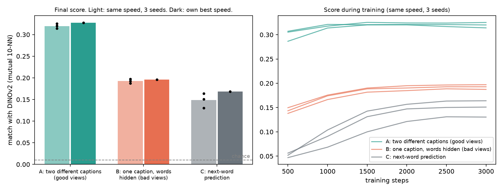

# platonic-lab

A small fact check of a claim from [Balestriero & LeCun, "Proving and Improving the Platonic
Representation Hypothesis with JEPAs" (2026)](https://github.com/galilai-group/prh-proof): text models learn a
picture of the world closer to an image model's when trained on **good views** (two different captions of one
photo) than on bad views (one caption, words hidden) or next-word prediction. The paper's big run used captions
written by an AI that looked at the photos. Here: human captions only, one laptop (M4 Pro), about 3 hours.



## Result
Score = mutual 10-nearest-neighbours between the text model's numbers for a caption and frozen DINOv2's numbers
for its photo, on 1000 held-out photos. Chance is 0.010.

| Method | same speed, 3 seeds | own best speed, 1 seed |
|---|---|---|
| A: two different captions (good views) | **0.320** | **0.328** |
| B: one caption, words hidden (bad views) | 0.192 | 0.196 |
| C: next-word prediction | 0.148 | 0.168 |

Full table with R@1: `results/table.md`. Every method uses the same encoder (4 layers, width 256), the same
captions, steps (3000), batch (256) and anti-collapse loss. Only the training pairs differ. The decision rule and
the learning-speed search were written into `src/lab.py`, `src/tune_lean.sh` and `src/tune_rerun.sh` before the runs.

## What this does not show
- Small models (about 9M parameters) and 8000 training photos. Not the paper's 109M or 72B results.
- Good views need to know which captions describe the same photo. People wrote those captions looking at the photos,
  so the supervision is not free. The paper says this too.
- Image-to-caption retrieval (R@1) shows a smaller gap than mutual 10-NN: 0.084 / 0.063 / 0.057 (same speed).
  Next-word prediction at its best speed has lower R@1 (0.049) than at the same speed, so tuning did not help it there.
- Next-word prediction's best speed (3e-3) was the top of the range tried. Faster might help it a little more.
- The tuned table has one seed per method. The same-speed table has three, with the same ordering.
- Only one dataset (COCO, first 10,000 train images), one image model (DINOv2-base).

## Run it
```
uv venv .venv && uv pip install torch torchvision transformers pillow numpy matplotlib
.venv/bin/python src/prep.py 10000          # download photos + captions, embed photos once (about 15 min)
src/run_all.sh data/coco_10000.pt            # 3 methods x 3 seeds (about 80 min on Apple silicon)
.venv/bin/python src/report.py               # table + chart
```
Needs a Mac with MPS (the scripts use `mps`). Change `dev` in `src/lab.py` and `src/prep.py` for CUDA or CPU.

Data: COCO via the `yerevann/coco-karpathy` dataset (image URLs + 5 human captions each).
Paper code, for the full-scale version: https://github.com/galilai-group/prh-proof (MIT).
